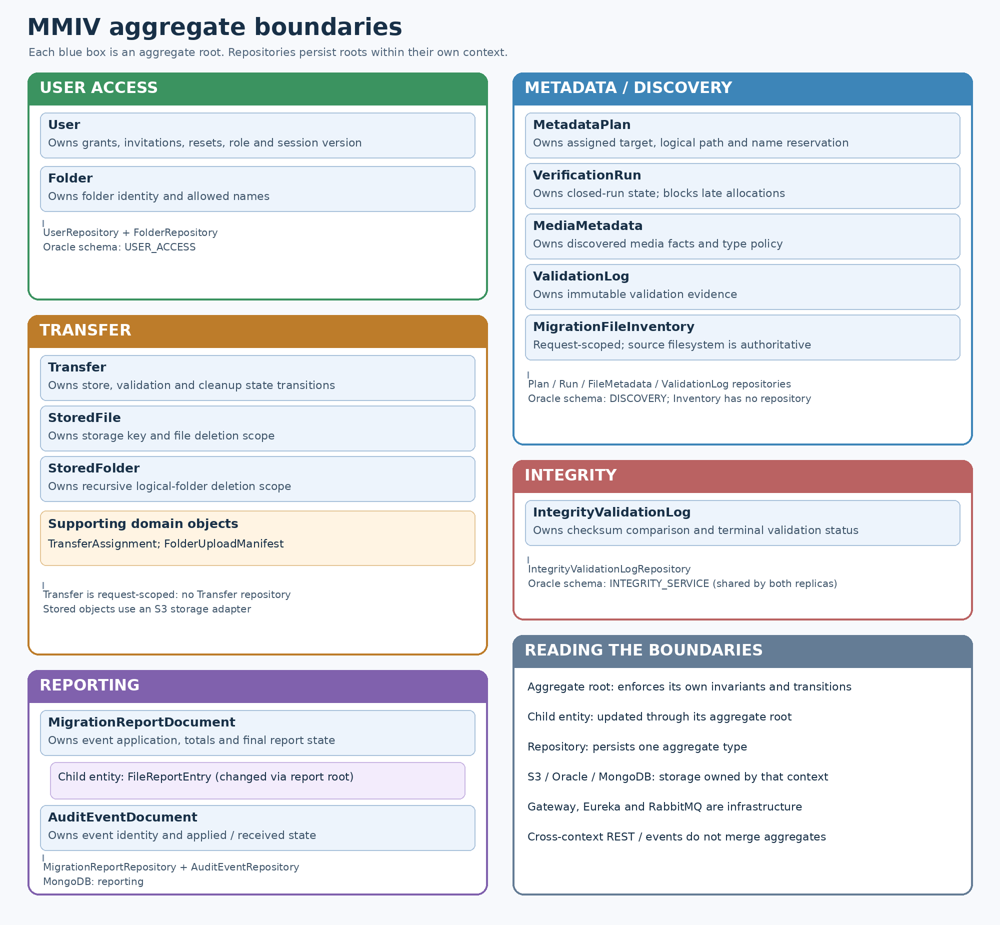
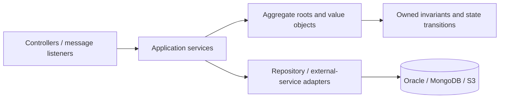

# Aggregate-centered domain design

This refactor places business decisions on domain objects while preserving HTTP
routes, JSON field names, event schemas, database tables. Horizontal replication and Gateway changes are documented separately.
Existing Spring services coordinate use cases; adapters perform HTTP, database,
filesystem, S3, RabbitMQ, cryptography, retry, and circuit-breaker operations.

## Bounded contexts and roots

The image source is `render-aggregates.py` (requires Pillow).

| Context            | Aggregate root                   | Rules owned by the root                                                                                                                                                    | Persistence boundary                                                |
| ------------------ | -------------------------------- | -------------------------------------------------------------------------------------------------------------------------------------------------------------------------- | ------------------------------------------------------------------- |
| User Access        | `User`                           | Folder-scoped authorization, administrator management restrictions, account deactivation, credential/session version transitions, role transitions, grant/revoke decisions | `UserRepository`: Oracle and test-memory implementations            |
| User Access        | `Folder`                         | Legal folder identity and reserved/administrator-created names                                                                                                             | `FolderRepository`: Oracle and test-memory implementations          |
| Metadata/Discovery | `MetadataPlan`                   | Valid media assignment, logical path, content type, server-owned target key, duplicate filename allocation, ownership and visibility                                       | `MetadataPlanRepository`                                            |
| Metadata/Discovery | `VerificationRun`                | Closed runs reject new plans; closure is idempotent                                                                                                                        | `VerificationRunRepository`                                         |
| Metadata/Discovery | `MigrationFileInventory`         | Manifest matching, missing/ambiguous files, size/type mismatches                                                                                                           | Request-scoped; no invented repository                              |
| Metadata/Discovery | `MediaMetadata`, `ValidationLog` | Discovered media facts/type policy and immutable validation evidence                                                                                                       | `FileMetadataRepository`, `ValidationLogRepository`, respectively   |
| Transfer           | `Transfer`                       | Store-before-validate, completion only after PASSED, required cleanup, terminal cleanup outcomes                                                                           | Request-scoped; no new database                                     |
| Transfer           | `StoredFile`, `StoredFolder`     | Uploader/admin deletion eligibility and recursive logical-folder selection                                                                                                 | Existing S3 storage adapters; Metadata retains assignment ownership |
| Integrity          | `IntegrityValidationLog`         | Pending-to-PASSED/FAILED/ERROR transitions; case-insensitive checksum comparison; terminal outcome protection                                                              | `IntegrityValidationLogRepository` (JPA)                            |
| Reporting          | `MigrationReportDocument`        | Event application, child file state, counts, final status, timeout and late-event behavior                                                                                 | `MigrationReportRepository` (MongoDB)                               |
| Reporting          | `AuditEventDocument`             | Payload identity and applied/received state                                                                                                                                | `AuditEventRepository` (MongoDB)                                    |

API Gateway and Service Registry are technical components. Routing, JWT transport
validation, and service registration are not business aggregates. Gateway now owns
browser sessions, account API routing, shared React assets and Redis admission limits. Shared event publishing/outbox and resilience code are infrastructure.

## Dependency and execution direction

Domain roots do not call Spring application services or remote systems. JPA and
Mongo mapping annotations remain on persistent roots so the existing schemas
and rehydration behavior remain stable. A mapping annotation is not a dependency
on an application service.

`TransferService` asks `Transfer.requiresCleanup()` after recording validation;
it executes deletion but does not decide transfer success. Integrity records a
comparison or I/O failure on its root before saving it. Metadata supplies observed
file facts to `MetadataPlan.assign`, then reserves an available name while the
repository holds the existing folder lock.

Reporting translates published JSON into a typed `ReportChange`, calls
`MigrationReportDocument.apply`, and saves the root. Application code can no
longer directly mutate `FileReportEntry` children. The root recalculates summary
and completion together. `ReportStateCalculator` remains a compatibility adapter
that delegates to the root; it contains no business rules. `UploadNames` likewise
forwards to the Metadata aggregate's naming policy.

## Repository ownership and concurrency

“One repository per aggregate” means one persistence boundary per **aggregate
type**, not one per table, and not one repository for an entire microservice.
User permissions and destination grants are account-owned children, not separately
saved roots. Report file entries are embedded children, with no file-entry
repository. Metadata name reservations are persisted with their plan; folder-name
lock rows are concurrency infrastructure, not a separate business entity.
Verification-run tombstones have their own repository rather than having their
SQL mixed with plan persistence. Legacy plan repository methods delegate run
operations for caller compatibility.

The existing repository command methods are retained. They load/apply domain
transitions and persist the corresponding change instead of requiring controllers
to overwrite an entire root with potentially stale state. Existing row locks,
unique constraints, conditional token consumption, and transaction boundaries
remain essential: an aggregate is not a substitute for database concurrency
control. SQL predicates enforcing single-use/expiry are retained as atomic
persistence guards. Folder deletion coordinates account grant removal through
`UserRepository`; the folder adapter no longer writes account grant rows itself.

Account invitation/reset records are account-owned lifecycle data managed by the
User repository. Deactivation retains historical records and expires links;
password reset increases the session version and invalidates outstanding links.
No separate token repository is introduced that could independently promote or
reset an account.

This change does not add a distributed transaction across S3, Oracle, RabbitMQ,
and MongoDB, or durable recovery for a request-scoped Transfer aggregate. Existing
cleanup, retry, outbox, and partial-failure behavior is preserved. Adding durable
transfer recovery would require a Transfer repository and an explicit recovery
protocol, rather than simply storing the current Java object.

## Regression validation

Focused domain tests cover transfer transitions, account management/access and
session invalidation, checksum outcomes, metadata path/name rules, and closed
verification runs. Existing service, controller, event-projector, security, and
repository tests continue to verify the external contracts. Oracle-enabled suites
and the seven-service integration harness exercise actual persistence, RabbitMQ,
MongoDB, and an S3 HTTP fixture; the fixture does not validate real AWS IAM or S3
service availability.

Validation performed for this refactor:

| Service            |                                 Passing checks |
| ------------------ | ---------------------------------------------: |
| User Access        | 130 regular tests + 9 Oracle integration tests |
| Metadata/Discovery | 80 regular tests + 12 Oracle integration tests |
| Transfer           |                                      151 tests |
| Integrity          |                                        8 tests |
| Reporting          |                                      145 tests |
| API Gateway        |                                        5 tests |
| Service Registry   |                                         1 test |

All seven Maven `verify` builds completed successfully. Discovery's 12
Oracle-dependent tests passed in the database-enabled run; they are deliberately
skipped in the ordinary database-free run. The database-free context test mocks
the newly separated VerificationRun repository along with the other repositories.

The seven-service integration harness also passed: admin login/invitations,
shared sessions and CSRF, folder permissions, upload/integrity/reporting,
concurrent filename reservations, verification cleanup, RabbitMQ outage recovery,
password-reset links, session revocation, soft deactivation, and protection of
other administrators. Its recovery check now waits for User Access's own gateway
route after the deliberate RabbitMQ outage, in addition to Transfer's route.
