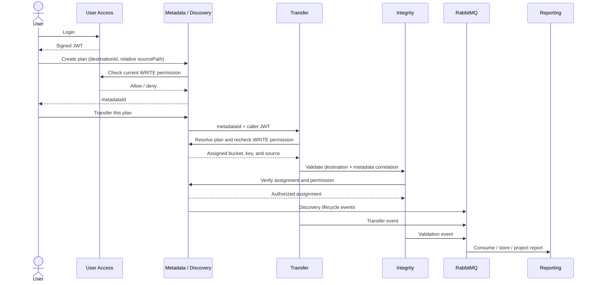

# Integrated service flow

User Access stores destination grants in Oracle. Discovery is also the metadata service: it checks the caller's current grant, validates media, and saves a destination assignment in `MMIV_TRANSFER_PLANS`. Transfer retrieves that assignment with the caller's JWT and writes only the bucket/key supplied by metadata. Integrity retrieves the same assignment before reading the destination. Reporting consumes the correlated lifecycle events from RabbitMQ and stores reports in MongoDB.



## Permission and destination configuration

The initial destination ID is the configured `MMIV_BUCKET_NAME`; override its ID with `MMIV_DESTINATION_ID`. The bucket is server configuration. Metadata creates keys under `migrations/<metadataId>/...`. A user may select the configured destination ID, but cannot supply a bucket or object key. The current S3 implementation supports one configured destination per stack.

Signup creates an account with no destination grants. An administrator grants access in the User Access database, for example with a parameterized statement:

```sql
INSERT INTO USER_DESTINATION_ACCESS (USER_ID, DESTINATION, PERMISSION)
VALUES (:user_id, :destination_id, 'WRITE');
COMMIT;
```

`READ` permits destination file reads and the caller's own metadata/reports. `WRITE` includes READ and permits discovery, assignment creation, and transfers. Grants are checked against User Access on each operation; revoking a grant takes effect even when the JWT has not expired. Permission-service failures deny the operation. Knowing another user's metadata ID does not authorize resolving or reading it.

## Gateway API

Use a JWT from `/user-access/api/auth/login` in `Authorization: Bearer ...` for service APIs. Browser uploads retain the existing HttpOnly session and CSRF protection; Transfer forwards the validated JWT to its peers.

1. `POST /api/metadata/plans` with `{"destinationId":"<configured ID>","sourcePath":"folder/file.pdf"}` creates an assignment for an existing readable file under the shared media root.
2. `POST /api/metadata/plans/{metadataId}/transfer` starts the transfer through metadata. Alternatively, `POST /api/v1/transfers` accepts **only** `{"metadataId":"<UUID>"}`. Legacy sourcePath/destinationKey requests without a metadata ID return 400.
3. `GET /api/reports/{migrationId}` returns the projected report. The migration ID is returned by metadata. Global report listing is denied to prevent exposing other users' reports.
4. `GET /api/metadata/plans/{metadataId}` reads owned metadata with READ permission. Assignments expire for new transfers after 24 hours; authorized metadata/report reads remain available.

Multipart `/api/v1/transfers` accepts `file` and an optional `destinationId`. Transfer asks metadata to validate and allocate the destination before any S3 write. `/api/v1/transfers/folder` accepts matching `files`/`relativePaths` and `destinationId`; it validates the complete folder and authorizes all allocations before writing. Metadata preserves the relative folder path beneath each server-generated assignment prefix.

`GET /api/v1/destinations` exposes the configured writable destination through the authenticated browser session. The upload page disables upload when that permission is absent.

## RabbitMQ logging and reports

All seven services publish service-ready, application log metadata, and HTTP request outcome records to the durable `mmiv.events` topic exchange with routing key `service.log`. HTTP records contain method, status, and duration. They omit request bodies, credentials, JWTs, cookies, arbitrary log messages, and filesystem paths.

Reporting consumes `mmiv.service.logs` and stores records in MongoDB's `service_logs` collection. `eventId` is the Mongo document ID, so redelivery cannot create duplicate log records. Malformed records go to `mmiv.service.logs.dlq`; database outages requeue valid records with a delay. Business events use the uploaded [version 2 contract](../../contracts/events/v2/README.md), the `reporting.events` queue, and its dead-letter queue.

Each producer has a separate persistent filesystem outbox. Events retain their IDs across retries/restarts and are removed only after a positive RabbitMQ publisher confirmation without an unroutable return. Broker outages therefore leave events pending for retry. A disk write failure is logged locally; a completed transfer is not converted into a retryable storage failure by logging errors.

The previous SQS producer has been removed. Existing Terraform SQS resources are retained to avoid destroying old queued logs during this application migration; no running service publishes to them. The old local Transfer outbox at `/var/lib/mmiv/transfer-log-outbox` is also retained. Drain or archive those historical records before separately retiring their infrastructure.

## Deployment and local validation

Cloud deployment now builds and enables all seven services. The EC2 lifecycle creates RabbitMQ/MongoDB credentials once on the host, reuses them on later deployments, and refuses silent password replacement when persistent data exists without its credential backup. RabbitMQ and MongoDB have no public ports. Reporting receives a Mongo user restricted to its reporting database.

Persistent data volumes are `mmiv-oracle-data`, `mmiv-rabbitmq-data`, and `mmiv-reporting-data`; service outboxes are under `/var/lib/mmiv/event-outbox/<service>`. Application rollback retains this infrastructure and its data. Host installation and existing EC2 reuse remain idempotent. Per-service memory limits keep the expanded stack within the existing 8 GiB instance budget.

The local Compose files in `infrastructure/service-registry` now include RabbitMQ, MongoDB, discovery, and reporting. Build each service JAR from the repository root first. Supply private Oracle/JWT configuration, a shared media directory, `RABBITMQ_PASSWORD`, and `MONGODB_PASSWORD`. Preserve these passwords when reusing data volumes. Do not run `compose down -v` when data should be retained.

A self-contained live test starts all seven JARs with temporary Oracle, RabbitMQ, MongoDB containers and a local S3 HTTP fixture:

```sh
for service in services/*; do mvn -f "$service/pom.xml" package; done
JAVA="${JAVA_HOME}/bin/java" python3 tests/integration/test-service-stack.py
```

Set `MMIV_ORACLE_MAVEN` to your Maven executable to run the User Access and Discovery Oracle integration suites against the same temporary database.

It tests permission denial, metadata-controlled transfer, integrity, report projection, grant revocation, logging from all services, broker outage recovery, and deletion of the generated test account. It uses no AWS resources. The S3 fixture exercises real SDK HTTP requests but does not validate AWS IAM.

CI continues to create a dedicated account through signup. For managed Oracle, an authorized SSM command grants only that cached generated USER account WRITE permission to the configured verification destination. No public API grants this permission. Supplied accounts are left unchanged and must already have the appropriate grant. External Oracle requires a supplied account. Cleanup deletes the generated account and its grants after verification, including failed verification runs.
