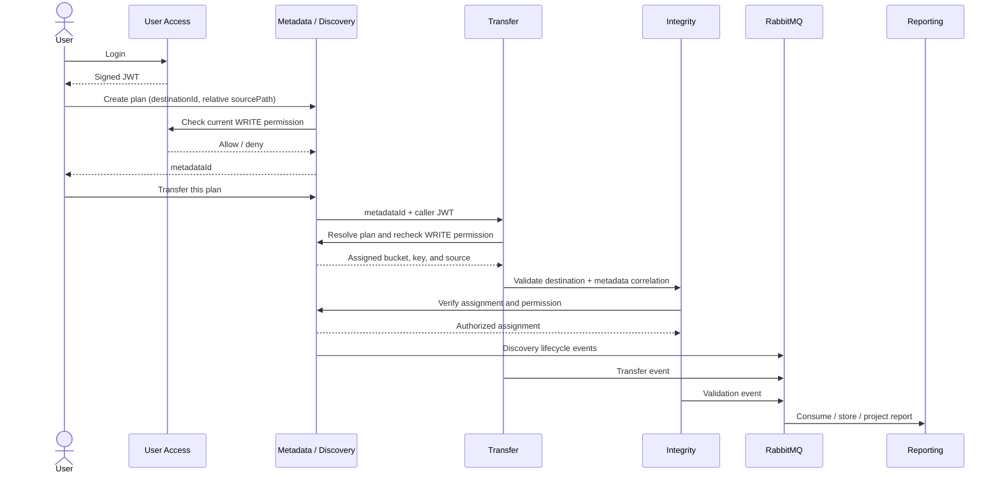
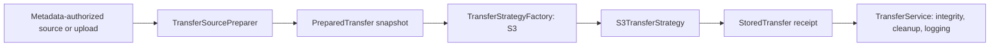

# Integrated service flow

[English](integration.md) | [简体中文](integration.zh-CN.md)

User Access stores destination grants in Oracle. Discovery is also the metadata service: it checks the caller's current grant, validates media, and saves a destination assignment in `MMIV_TRANSFER_PLANS`. Transfer retrieves that assignment with the caller's JWT and writes only the bucket/key supplied by metadata. Integrity retrieves the same assignment before reading the destination. Reporting consumes the correlated lifecycle events from RabbitMQ and stores reports in MongoDB.



## Permission and destination configuration

`MMIV_BUCKET_NAME` remains the server-configured bucket. Destination IDs now name registered top-level folders inside it. Administrators create folders through the portal and Oracle stores the catalog in `MMIV_FOLDERS`. Metadata verifies the folder exists and the current WRITE grant, then assigns `<folder>/migrations/<metadataId>/<relativePath>`. The UUID prevents concurrent or same-name uploads from overwriting each other; the browser hides that storage detail. Users cannot choose arbitrary buckets or object keys. Existing root objects and bucket grants are retained but are not automatically migrated or exposed as folders.

Signup creates an account with no destination grants. Administrators manage grants through `/admin.html`; see [administrator access and invitations](../admin/administrator-access.md). Authorized database operators can also use a parameterized statement:

```sql
INSERT INTO USER_DESTINATION_ACCESS (USER_ID, DESTINATION, PERMISSION)
VALUES (:user_id, :destination_id, 'WRITE');
COMMIT;
```

`READ` permits browsing and downloading shared-folder files and reading their metadata/reports. `WRITE` includes READ and permits discovery, assignment creation, and transfers. Grants are checked against User Access on each operation; revoking a grant takes effect even when the JWT has not expired. Permission-service failures deny the operation. Resolving or transferring a plan still requires its owner; reading requires the assigned folder's READ permission. Active administrators have access to registered folders.

## Gateway API

Use a JWT from `/user-access/api/auth/login` in `Authorization: Bearer ...` for service APIs. Browser requests use Gateway's HttpOnly session and CSRF protection; Gateway validates the cookie and relays a verified Bearer token to the owning backend.

1. `POST /api/metadata/plans` with `{"destinationId":"<configured ID>","sourcePath":"folder/file.pdf"}` creates an assignment for an existing readable file under the shared media root.
2. `POST /api/metadata/plans/{metadataId}/transfer` starts the transfer through metadata. Alternatively, `POST /api/v1/transfers` accepts **only** `{"metadataId":"<UUID>"}`. Legacy sourcePath/destinationKey requests without a metadata ID return 400.
3. `GET /api/reports/mine` lists only reports owned by the JWT subject. `GET /api/reports/{migrationId}` returns an owned projected report; another user's ID returns 404. The migration ID is returned by metadata. Cross-user listing remains administrator-only.
4. `GET /api/metadata/plans/{metadataId}` reads shared-folder metadata with READ permission. Assignments expire for new transfers after 24 hours; authorized metadata/report reads remain available.

Multipart `/api/v1/transfers` accepts `file` and an optional `destinationId`. Transfer asks metadata to validate and allocate the destination before any S3 write. `/api/v1/transfers/folder` accepts matching `files`/`relativePaths` and `destinationId`; it validates the complete folder and authorizes all allocations before writing. Metadata preserves the relative folder path beneath each server-generated assignment prefix.

`GET /api/v1/destinations` exposes the configured writable destination through the authenticated browser session. The upload page disables upload when that permission is absent.

## Transfer strategy and factory

`TransferService` explicitly requests a `TransferBackend`, and `TransferStrategyFactory` selects it with a switch. Spring creates and injects the concrete S3 strategy; it does not choose from a strategy list. Selection uses neither bean ordering nor response times, and it never races uploads. The implemented backend is S3: the current metadata contract assigns S3 destinations, so `TransferService` selects `TransferBackend.S3` on the server. File extensions determine validation and content type.

Both metadata-authorized local sources and multipart uploads use `TransferSourcePreparer`. It validates the input, copies it into a private temporary snapshot, enforces the configured size limit while reading, and computes SHA-256 during that same copy. Local sources and uploads must be nonempty and within `mmiv.upload.max-size-bytes` (100 MiB by default). This prevents an oversized actual stream from bypassing an advertised upload size. The snapshot remains stable if the original source changes and is closed after the operation, including failures.

Each strategy has one operation, `transfer(PreparedTransfer)`, and returns a `StoredTransfer` receipt containing the bucket, assigned key, and exact object version/ETag. `S3TransferStrategy` only writes those prepared bytes with their checksum. `TransferService` owns the shared integrity retry, guarded remote cleanup, API response mapping, and RabbitMQ logging. Metadata remains responsible for destination assignment and permission checks; the public API still accepts a metadata ID rather than arbitrary source paths or object keys. No non-S3 transfer backend is implemented.



## RabbitMQ logging and reports

All seven services publish service-ready, application log metadata, and HTTP request outcome records to the durable `mmiv.events` topic exchange with routing key `service.log`. HTTP records contain method, status, and duration. They omit request bodies, credentials, JWTs, cookies, arbitrary log messages, and filesystem paths.

Reporting consumes `mmiv.service.logs` and stores records in MongoDB's `service_logs` collection. `eventId` is the Mongo document ID, so redelivery cannot create duplicate log records. Malformed records go to `mmiv.service.logs.dlq`; database outages requeue valid records with a delay. Business events use the uploaded [version 2 contract](../contracts/events/v2/README.md), the `reporting.events` queue, and its dead-letter queue.

Each producer has a separate persistent filesystem outbox. Events retain their IDs across retries/restarts and are removed only after a positive RabbitMQ publisher confirmation without an unroutable return. Broker outages therefore leave events pending for retry. A disk write failure is logged locally; a completed transfer is not converted into a retryable storage failure by logging errors.

The previous SQS producer has been removed. Existing Terraform SQS resources are retained to avoid destroying old queued logs during this application migration; no running service publishes to them. The old local Transfer outbox at `/var/lib/mmiv/transfer-log-outbox` is also retained. Drain or archive those historical records before separately retiring their infrastructure.

## Deployment and local validation

Cloud deployment now builds and enables all seven services. The EC2 lifecycle creates RabbitMQ/MongoDB credentials once on the host, reuses them on later deployments, and refuses silent password replacement when persistent data exists without its credential backup. RabbitMQ and MongoDB have no public ports. Reporting receives a Mongo user restricted to its reporting database.

Persistent data volumes are `mmiv-oracle-data`, `mmiv-rabbitmq-data`, and `mmiv-reporting-data`; service outboxes are under `/var/lib/mmiv/event-outbox/<service>`. Application rollback retains this infrastructure and its data. Host installation and existing EC2 reuse remain idempotent. Per-service memory limits keep the expanded stack within the existing 8 GiB instance budget.

The local Compose files in `infrastructure/service-registry` now include RabbitMQ, MongoDB, discovery, and reporting. Build each service JAR from the repository root first. Supply private Oracle/JWT configuration, a shared media directory, `RABBITMQ_PASSWORD`, and `MONGODB_PASSWORD`. Preserve these passwords when reusing data volumes. Do not run `compose down -v` when data should be retained.

A self-contained live test starts all seven JARs with temporary Oracle, RabbitMQ, MongoDB containers and a local S3 HTTP fixture:

```sh
for service in services/*; do mvn -f "$service/pom.xml" package; done
JAVA="${JAVA_HOME}/bin/java" python3 tests/integration/test-service-stack.py
```

Set `MMIV_ORACLE_MAVEN` to your Maven executable to run the User Access and Discovery Oracle integration suites against the same temporary database.

It tests permission denial, metadata-controlled transfer, integrity, report projection, grant revocation, logging from all services, broker outage recovery, and deletion of the generated test account. It uses no AWS resources. The S3 fixture exercises real SDK HTTP requests but does not validate AWS IAM.

CI continues to create a dedicated account through signup. For managed Oracle, an authorized SSM command grants only that cached generated USER account WRITE permission to the configured verification destination. No public API grants this permission. Supplied accounts are left unchanged and must already have the appropriate grant. External Oracle requires a supplied account. Cleanup deletes the generated account and its grants after verification, including failed verification runs.

Each verification invocation uses a UUID in `X-MMIV-Verification-Run`. Metadata records that ID when allocating plans. Final cleanup authenticates the owner and checks current WRITE permission, closes the run, waits for admitted transfers, deletes all S3 versions and delete markers at each assigned test key, removes associated reports, migration audit events and file logs, then removes the plans. Account cleanup runs last. Other owners, other runs and ordinary untagged uploads remain untouched, including when verification uses a supplied account. Cleanup failure fails verification and keeps plans available for investigation/retry.

Temporary run-ID files are removed. Minimal closed-run markers in Oracle and migration tombstones in MongoDB remain to reject delayed writes/events; CI cleanup evidence also retains the run ID. General operational logs and scan artifacts remain. Cleanup applies only to verification runs carrying a run tag and does not sweep older untagged test data.
