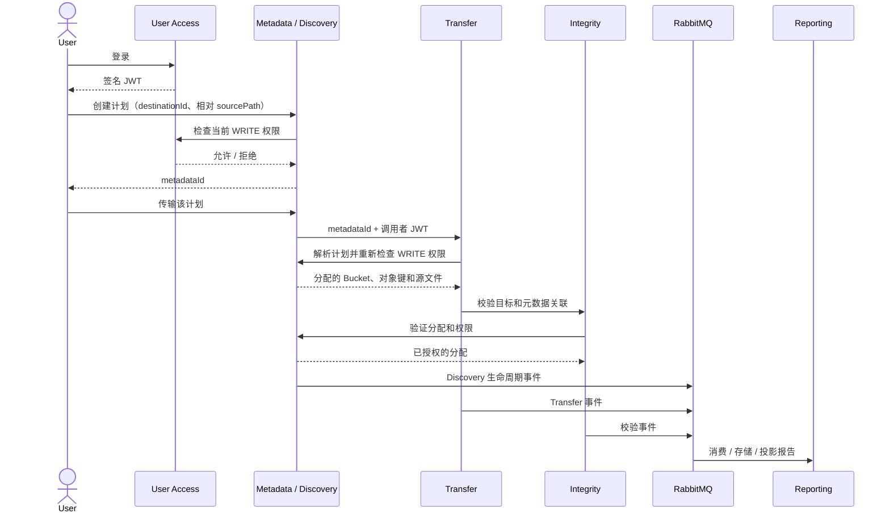
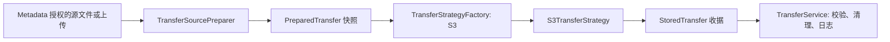

# 服务集成流程

[English](integration.md) | [简体中文](integration.zh-CN.md)

User Access 在 Oracle 中保存目标授权。Discovery 同时提供元数据服务：检查
调用者当前授权、验证媒体，并将目标分配保存到 `MMIV_TRANSFER_PLANS`。
Transfer 携带调用者 JWT 获取分配信息，只能写入元数据服务提供的 Bucket/对象键。
Integrity 读取目标前也会获取同一分配信息。Reporting 消费相关联的生命周期事件，
并将报告写入 MongoDB。



## 权限与目标配置

`MMIV_BUCKET_NAME` 仍是服务端配置的 Bucket。目标 ID 表示 Bucket 内已登记的
顶层文件夹。管理员通过 portal 创建文件夹，Oracle 将目录写入 `MMIV_FOLDERS`。
Metadata 验证文件夹存在且当前用户有 WRITE 权限，然后分配
`<folder>/migrations/<metadataId>/<relativePath>`。UUID 可防止并发或同名上传
覆盖；浏览器隐藏实际存储路径。用户不能选择任意 Bucket 或对象键。现有根目录
对象和 Bucket 授权会保留，但不会自动迁移或作为文件夹公开。

新账户默认没有目标权限。管理员通过 `/admin.html` 管理授权，详见
[管理员访问](../admin/administrator-access.md)。具备权限的数据库管理员也可
使用参数化 SQL：

```sql
INSERT INTO USER_DESTINATION_ACCESS (USER_ID, DESTINATION, PERMISSION)
VALUES (:user_id, :destination_id, 'WRITE');
COMMIT;
```

`READ` 允许浏览、下载共享文件夹文件及读取其元数据/报告；`WRITE` 包含 READ，
并允许发现、创建分配和传输。每项操作都会向 User Access 检查当前授权；即使
JWT 尚未过期，撤销授权也会立即生效。权限服务故障时拒绝操作。解析或传输计划
仍须由计划所有者执行；读取要求对分配文件夹有 READ 权限。激活的管理员可访问
已登记文件夹。

## Gateway API

服务 API 使用 `/user-access/api/auth/login` 返回的 JWT。浏览器请求使用
Gateway HttpOnly session 和 CSRF 防护；Gateway 验证 Cookie 并将可信身份转发
至对应后端。

1. `POST /api/metadata/plans` 携带
   `{"destinationId":"<configured ID>","sourcePath":"folder/file.pdf"}`，
   为共享媒体根目录下的现有可读文件创建分配。
2. `POST /api/metadata/plans/{metadataId}/transfer` 通过 Metadata 启动传输。
   或调用 `POST /api/v1/transfers`，其请求只接受
   `{"metadataId":"<UUID>"}`。缺少 metadata ID 的旧 `sourcePath`/
   `destinationKey` 请求返回 400。
3. `GET /api/reports/mine` 仅列出 JWT subject 所有的报告。
   `GET /api/reports/{migrationId}` 返回本人拥有的投影报告；其他用户的 ID
   返回 404。migration ID 由 Metadata 返回。跨用户列表仅限管理员。
4. `GET /api/metadata/plans/{metadataId}` 要求目标文件夹 READ 权限。分配仅在
   新传输时有效 24 小时；获授权的元数据/报告读取仍可继续。

多部分 `POST /api/v1/transfers` 接受 `file` 和可选 `destinationId`。Transfer
会在写入 S3 前要求 Metadata 验证并分配目标。
`POST /api/v1/transfers/folder` 接受配对的 `files`/`relativePaths` 及
`destinationId`；写入前验证整个文件夹并授权所有分配。Metadata 会在服务端
生成的分配前缀下保留相对文件夹路径。

`GET /api/v1/destinations` 通过已认证浏览器会话提供配置的可写目标。若用户
没有相应权限，上传页会禁用上传。

## Transfer 策略与工厂

`TransferService` 明确请求 `TransferBackend`，`TransferStrategyFactory` 通过
switch 选择实现。Spring 创建并注入具体的 S3 strategy；不根据 strategy 列表、
Bean 顺序或响应时间选择，也不会竞速多个上传。当前唯一实现的后端是 S3：
Metadata 仅分配 S3 目标，因此服务端选择 `TransferBackend.S3`。文件扩展名用于
输入验证和内容类型判断。

Metadata 授权的本地源文件和多部分上传均使用 `TransferSourcePreparer`。它验证
输入，将内容复制到私有临时快照，在读取时强制执行大小限制，并在同一复制过程
中计算 SHA-256。源文件和上传必须非空，且不超过 `mmiv.upload.max-size-bytes`
（默认 100 MiB）。这样可避免实际数据流超出声明上传大小。快照在源文件变化时
保持稳定，并会在包括失败在内的所有操作结束后关闭。

每个 strategy 只执行 `transfer(PreparedTransfer)`，并返回包含 Bucket、分配
对象键和精确对象 version/ETag 的 `StoredTransfer` 收据。`S3TransferStrategy`
只负责写入已准备的数据和 checksum。`TransferService` 负责共享完整性重试、
受保护的远端清理、API 响应映射和 RabbitMQ 日志。Metadata 负责目标分配和权限
检查；公共 API 接收 metadata ID，而不是任意源路径或对象键。当前没有实现
非 S3 传输后端。



## RabbitMQ 日志与报告

七个服务都会将就绪状态、应用日志元数据和 HTTP 请求结果发布到 durable
topic exchange `mmiv.events`，routing key 为 `service.log`。HTTP 记录包含
方法、状态码和耗时；不含请求正文、凭据、JWT、Cookie、任意日志消息或文件系统
路径。

Reporting 消费 `mmiv.service.logs` 并写入 MongoDB 的 `service_logs` collection。
`eventId` 作为 Mongo 文档 ID，避免重投递导致重复记录。格式错误的记录进入
`mmiv.service.logs.dlq`；数据库故障时有效记录延迟重入队。业务事件使用
[契约 v2](../contracts/events/v2/README.zh-CN.md)、`reporting.events` queue
及其死信队列。

每个发布服务有独立的持久文件系统 outbox。事件重试/重启后保留 ID；只有在收到
RabbitMQ publisher confirmation 且没有 unroutable return 后才会移除。因此
Broker 故障会让事件保留等待重试。磁盘写失败会本地记录，但不会因此将已经完成
的传输伪装成可重试的存储故障。

旧 SQS 发布方已移除。现有 Terraform SQS 资源仍保留，以免销毁历史排队日志；
运行中的服务不会向其发布。旧 Transfer outbox `/var/lib/mmiv/transfer-log-outbox`
也会保留。应先排空或归档历史记录，再单独退役其基础设施。

## 部署与本地验证

云部署会构建并启用七个服务。EC2 生命周期会在主机上首次创建 RabbitMQ/
MongoDB 凭据，后续部署复用；若持久数据存在但凭据备份缺失，会拒绝静默替换
密码。RabbitMQ 和 MongoDB 没有公共端口。Reporting 使用仅限报告数据库的
Mongo 用户。

持久数据卷为 `mmiv-oracle-data`、`mmiv-rabbitmq-data`、
`mmiv-reporting-data`；服务 outbox 位于
`/var/lib/mmiv/event-outbox/<service>`。应用回滚保留这些基础设施和数据。主机
安装与现有 EC2 复用是幂等操作。每服务内存限制用于将扩展后的堆栈控制在现有
8 GiB 实例预算内。

`infrastructure/service-registry` 下的本地 Compose 文件包含 RabbitMQ、
MongoDB、Discovery 和 Reporting。先在仓库根目录构建每个服务 JAR。提供私有
Oracle/JWT 配置、共享媒体目录、`RABBITMQ_PASSWORD` 和 `MONGODB_PASSWORD`。
复用数据卷时必须保留这些密码。需要保留数据时不要运行 `compose down -v`。

独立实时测试会启动七个 JAR、临时 Oracle/RabbitMQ/MongoDB 容器和本地 S3 HTTP
fixture：

```sh
for service in services/*; do mvn -f "$service/pom.xml" package; done
JAVA="${JAVA_HOME}/bin/java" python3 tests/integration/test-service-stack.py
```

设置 `MMIV_ORACLE_MAVEN` 为 Maven 可执行文件，可在同一临时数据库上运行
User Access 和 Discovery Oracle 集成测试。该测试验证权限拒绝、元数据控制的
传输、完整性、报告投影、授权撤销、全服务日志、Broker 故障恢复和测试账户删除。
它不使用 AWS 资源。S3 fixture 使用真实 SDK HTTP 请求，但不验证 AWS IAM。

CI 继续通过注册流程创建专用账户。对于托管 Oracle，经授权的 SSM 命令仅为
缓存的生成 USER 账户授予配置验证目标的 WRITE 权限；没有公共 API 可授予该
权限。提供的账户保持不变，并须预先具备合适授权。外部 Oracle 必须提供账户。
验证后（包括失败验证）会清理生成账户及授权。

每次验证调用都会在 `X-MMIV-Verification-Run` 中使用 UUID。Metadata 在分配
计划时记录 ID。最终清理会以所有者身份验证并检查当前 WRITE 权限、关闭运行、
等待已接收的传输、删除测试对象键的所有 S3 版本和 delete marker、移除相关
报告、迁移审计事件和文件日志，最后移除计划。账户最后清理。其他所有者、
其他运行和普通未标记上传不会被改动，即使验证使用的是已提供账户。清理失败会
使验证失败，并保留计划供调查/重试。

临时 run-ID 文件会删除；Oracle 中最小化的 closed-run marker 和 MongoDB
migration tombstone 会保留，以拒绝延迟写入/事件；CI 清理证据也会保留 run ID。
普通运行日志和扫描产物保留。清理仅适用于带 run tag 的验证运行，不会扫描或
删除较早的未标记测试数据。
