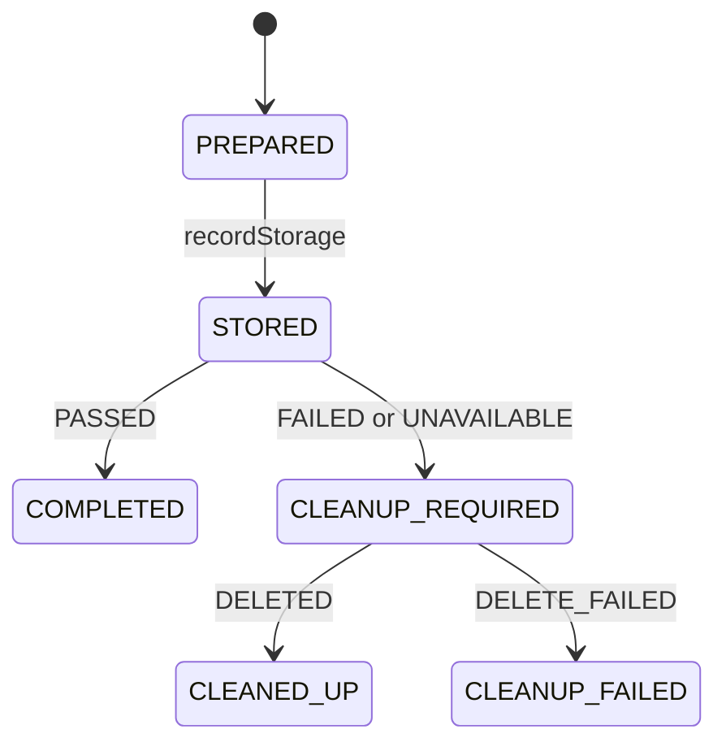

# Transfer domain design

The synchronous upload/transfer lifecycle is centered on the `domain.Transfer`
aggregate root. Its identity is the existing transfer UUID returned by the API
and sent to Integrity. It owns its storage receipt, validation result, cleanup
result, and lifecycle state. These immutable value objects can only be attached
through guarded aggregate operations.

## Invariants

- Storage must be recorded before validation.
- Only PASSED validation completes a transfer successfully.
- FAILED and UNAVAILABLE validation require cleanup.
- A successful transfer cannot enter cleanup.
- Cleanup success does not turn an unsuccessful transfer into a successful one.
- Cleanup failure remains visible for manual intervention.
- Storage, validation, and cleanup cannot be overwritten after their transitions.

## Responsibilities

`TransferService` is the application coordinator. It prepares bytes, invokes the
explicit Strategy Factory, records the storage receipt in the aggregate, calls
Integrity, records the translated result, executes cleanup when the aggregate
requires it, and maps the final state to the existing response and audit event.
It retains the existing public methods for controller and Metadata integration.

`Transfer` has no Spring, HTTP, S3 SDK, database, or application-service imports.
The domain decides whether cleanup is required; `S3ObjectCleanup` performs the
conditional, version-aware deletion with the existing retry policy.
`IntegrityValidationGateway` remains the anti-corruption boundary responsible
for checking remote response identity and consistency, and retry/circuit behavior.
`TransferSourcePreparer` retains temporary-file and stream resource management.
Strategy selection remains explicit in the factory workflow.

Folder permissions, destination allocation, and name reservations remain owned
by their existing User Access/Metadata boundaries. This refactor does not move
those business capabilities into the Transfer aggregate. File browsing and
administrative deletion are separate use cases, not transfer lifecycle states.

## Persistence and compatibility

The Transfer aggregate is request-scoped and is not persisted. No aggregate
repository is introduced because the existing workflow has no durable Transfer
aggregate to load or resume. S3 stores file bytes, while Metadata continues to
persist plans and reservations. Neither the S3 strategy nor MetadataClient is
presented as a Transfer aggregate repository.

If durable transfer recovery is added later, introduce one `TransferRepository`
for the aggregate root and persist its state as a unit; do not introduce separate
repositories for its receipt, validation, and cleanup value objects. That change
would require a separate persistence and recovery design.

Existing routes, response field names/status strings/messages, S3 destination
selection, checksum validation, retries, conditional cleanup, logging, and
snapshot disposal remain in place. Existing service/controller/integration tests
verify compatibility; `domain.TransferTest` checks lifecycle invariants without
Spring or external services.
